<p align="center">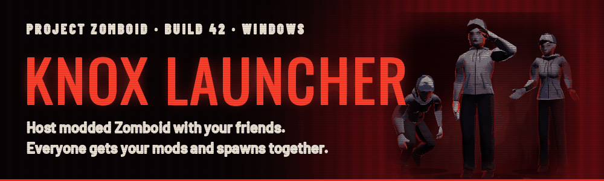</p>

Knox Launcher is a Windows app for playing modded Project Zomboid (Build 42) with friends. You set everything up in the app. Press START and everyone's game opens, joins and spawns in the same place.

<p align="center"><a href="../../releases/latest"></a></p>

You also need the **Knox Link** mod from the Steam Workshop. It's the part that runs inside the game.

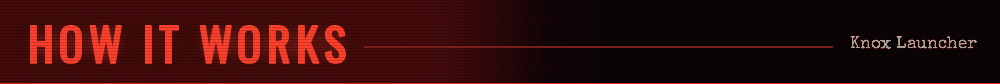

1. Download the app and subscribe to Knox Link on the Workshop.
2. Make a tape. A tape is one world.
3. Invite friends. They pick their survivors.
4. Press START. Everyone's mods download and the game opens for all of you.

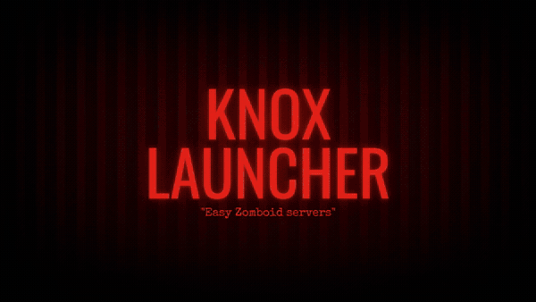

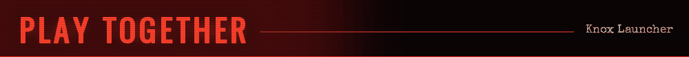

- Your game shows up on your friends' shelves. They click JOIN.
- They get your exact mod list. It downloads for them.
- Everyone waits until the whole squad is in, then you all spawn in the same building.
- Pick a story with roles. There are 30 built in, or write your own and share it with a code.

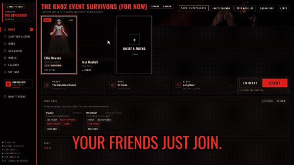

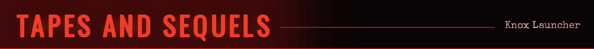

- Every world is a VHS tape on your shelf.
- Each time you play it again, it's the next part. Your survivors are still there.
- "Previously on..." shows who's alive and who died.
- Pick how many lives you get: unlimited, dead is dead, 3 each, or a shared pool for the squad.

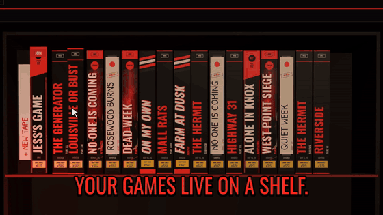

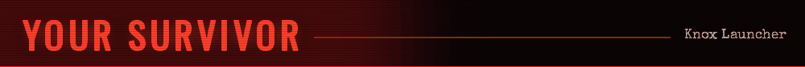

- Name, job, traits, look and clothes, with a 3D preview.
- The game fills it in for you, so you skip the character screen.

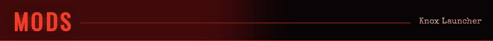

- Turn mods on and off, search the Workshop and subscribe, all in the app.
- It sorts the load order for you and tells you which mods can't load and why.
- Save mod lists as packs and share them with a code.

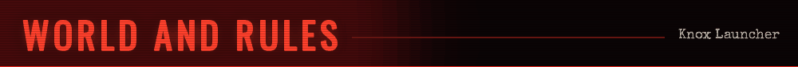

- Every server and sandbox setting, with the game's own names.
- 20 difficulty presets, a starting kit, and a spawn spot you pick on the map.
- Choose what happens when someone dies.

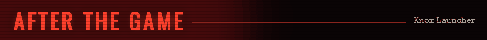

- While you play, the host sees everyone's health and kills and can kick, ban or message.
- When you close the game, you get a recap and a poster of your squad.
- Your world is backed up every time you host. Roll back with one click.

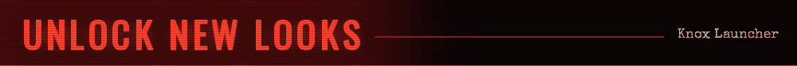

- Play to level up and unlock new covers, spines and poster styles for your tapes.
- They're only looks. Nothing changes the game.

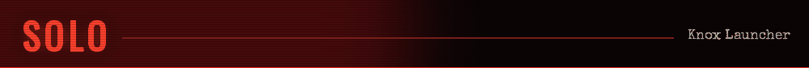

Use the same setup for a single-player game. Solo worlds go on the same shelf.

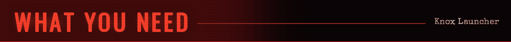

- Windows and Project Zomboid Build 42.
- [ZombieBuddy](https://steamcommunity.com/sharedfiles/filedetails/?id=3619862853) for some mods. The app can set it up for you.

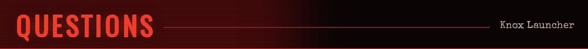

**Do my friends need the app?** Yes. Everyone needs the same version, and it updates itself.

**Do I need a dedicated server?** No. The game runs on the host's PC.

**Can I use mods that aren't on the Workshop?** Not with friends. They'd have to copy them in by hand.

**Mac or Linux?** Windows only for now.

**Something broke?** [Report a bug](../../issues) and attach `knoxlauncher.log` from `%APPDATA%\KnoxLauncher`.

---

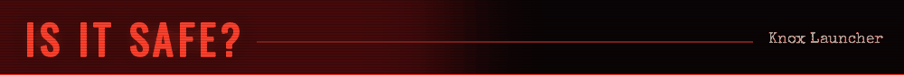

- All the code is in this repo. Anyone can read it.
- Every release is built by GitHub Actions from this code, not on someone's PC. The build log is linked on each release.
- Each release has a `SHA256SUMS.txt`. To check your download, run `Get-FileHash .\KnoxLauncher.exe` in PowerShell and compare.
- It only touches your Project Zomboid folders and its own settings.
- Windows might say "Windows protected your PC". That's because the app isn't code-signed. Click More info, then Run anyway.
- Not sure? Upload the file to [virustotal.com](https://www.virustotal.com) and see what it says.

### Building it yourself

Needs Go 1.24.

```
cd launcher
go test ./...
GOOS=windows GOARCH=amd64 go build -trimpath -ldflags "-H=windowsgui" -o KnoxLauncher.exe .
```

`launcher/` is the app, `mod/` is Knox Link, `server/` is the community server for shared stories and packs.

### Disclaimers

- Knox Launcher is a fan project. It isn't made by or affiliated with The Indie Stone or Valve. Project Zomboid is a trademark of The Indie Stone.
- Provided as is, with no warranty. Back up worlds you care about.
- MIT License, see [LICENSE](LICENSE). Bundled libraries and fonts keep their own licenses: three.js, Preact and htm (MIT), go-webview2, gopher-lua, golang.org/x/sys, and Google Fonts (SIL Open Font License).
